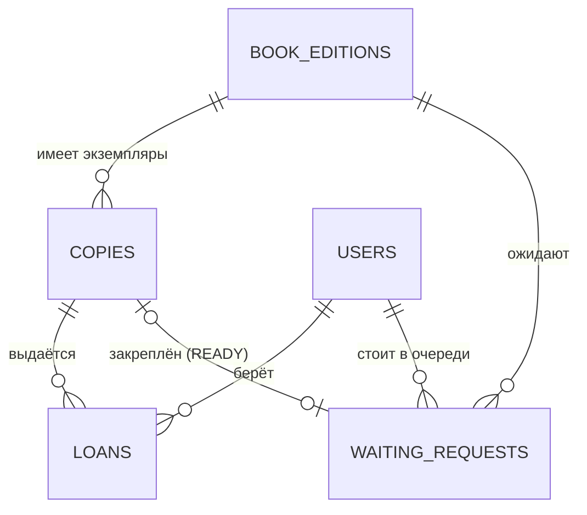

# Библиотечный абонемент

REST-сервис для учёта книг и выдач в библиотеке: каталог изданий, физические экземпляры, выдачи читателям и очередь
на книги, которых сейчас нет в наличии. Данные хранятся в PostgreSQL.

**Стек:** Java 21, Spring Boot 4.1, Spring Data JPA, PostgreSQL, Maven.

## Предметная модель

| Сущность | Эндпоинт | Назначение |
|---|---|---|
| Книжное издание | `/api/book-editions` | название, автор, ISBN (уникален) |
| Экземпляр | `/api/copies` | физическая копия издания: инвентарный номер (уникален), состояние `NEW/GOOD/WORN/DAMAGED` |
| Выдача | `/api/loans` | экземпляр, читатель, дата выдачи, срок возврата, дата возврата, число продлений |
| Заявка на ожидание | `/api/waiting-requests` | издание, читатель, дата постановки, статус `WAITING/READY/FULFILLED/CANCELLED` |
| Пользователь | `/api/users` | читатель библиотеки |

Для каждой сущности доступны `GET` (список и по id), `POST`, `PATCH`, `DELETE`. Время (даты выдачи, постановки в очередь,
возврата) всегда задаёт сервер.

## Целостность данных

Основные правила заданы в самой БД (`db/02_schema.sql`):
- внешние ключи с `ON DELETE CASCADE`: при удалении издания, экземпляра или читателя связанные записи удаляются, висячих ссылок нет;
- `UNIQUE` на ISBN, e-mail и инвентарный номер;
- частичный уникальный индекс: экземпляр не может быть на руках у двух читателей одновременно;
- читатель не может дважды стоять в очереди на одно издание;
- `CHECK` на даты, число продлений, допустимые состояния и статусы; закреплённый экземпляр есть у заявки тогда и только тогда, когда она `READY`.

Приложение работает под отдельным пользователем БД `library_app`, у которого есть только `SELECT/INSERT/UPDATE/DELETE`
на таблицы (без права менять структуру). Логин, пароль и адрес БД лежат в файле `.env`, в git он не попадает.

## Бизнес-операции

Все операции выполняются в одной транзакции: при нарушении правила ничего не меняется и возвращается `409 Conflict`.

| Операция | Эндпоинт | Что делает и когда запрещена |
|---|---|---|
| Выдача | `POST /api/operations/checkout` | Создаёт выдачу на 14 дней. Нельзя: экземпляр повреждён, уже на руках или закреплён за другим читателем; у читателя есть просрочка, уже 3 книги на руках или на руках это же издание. Если экземпляр был закреплён за этим читателем, заявка становится `FULFILLED` |
| Возврат | `POST /api/operations/loans/{id}/return` | Закрывает выдачу, в ответе видно, была ли просрочка. Экземпляр закрепляется за первым в очереди (`WAITING` → `READY`) или освобождается. Если книгу вернули повреждённой (`{"condition": "DAMAGED"}`), она больше не выдаётся. Нельзя вернуть уже возвращённую выдачу |
| Продление | `POST /api/operations/loans/{id}/renew` | Продлевает срок на 14 дней. Нельзя: выдача возвращена или просрочена, уже 2 продления, на издание есть очередь |
| Постановка в очередь | `POST /api/operations/waiting-list` | Создаёт заявку `WAITING`. Нельзя: у издания нет экземпляров, есть свободный экземпляр, издание уже на руках у читателя, читатель уже в очереди |
| Отмена заявки | `POST /api/operations/waiting-requests/{id}/cancel` | Отменяет `WAITING` или `READY` заявку. Если за ней был закреплён экземпляр, он передаётся следующему в очереди или освобождается |

CRUD-эндпоинты выдач и заявок - низкоуровневые, они не проверяют бизнес-правила (за них отвечают операции выше), но
ограничения БД действуют и для них.

## Запуск

1. Установить PostgreSQL и pgAdmin.
2. В pgAdmin выполнить `db/01_create_role.sql` (под `postgres`), заменив пароль, и создать базу `library`.
3. Подключиться к `library` и выполнить `db/02_schema.sql`, затем (по желанию) `db/03_test_data.sql`.
4. Скопировать `.env.example` в `.env` и вписать свой пароль.
5. Запустить `Lab3Application` (по умолчанию `http://localhost:8080`).

## Проверка

Импортировать в Postman `lab3.postman_collection.json` (имя файла коллекции из репозитория). В ней две папки:
`1. CRUD` (создание, чтение, изменение и удаление по каждой сущности) и `2. Сценарий бизнес-операций`
(полный сценарий: выдача, конфликт, очередь, возврат с закреплением, продление, отмена). Папки запускаются
через Run collection по порядку.
